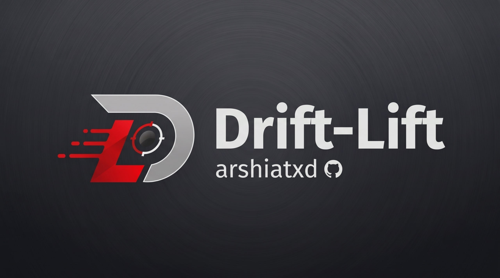

<div align="center">

# Drift Lift

**Gamepad controller calibration, real-time stick drift elimination, and remapping suite for Windows.**

<br/>

[](https://github.com/arshiatxd/Drift-Lift)
[](https://dotnet.microsoft.com/)
[-00C853)](https://github.com/arshiatxd/Drift-Lift/releases)
[](https://driftlift.netlify.app/)
[](LICENSE)

<br/>



<br/>

[Overview](#overview) · [Key Features](#key-features) · [Supported Controllers](#supported-controllers) · [Installation](#installation) · [System Requirements](#system-requirements) · [Changelog](CHANGELOG.md) · [License](#license)

</div>

---

## Overview

**Drift Lift** is an open-source Windows application designed to diagnose, calibrate, and eliminate analog stick drift on gamepads without forcing players to expand in-game deadzones. By combining 1000Hz low-latency polling, real-time center offset subtraction, and direct driver integration (ViGEmBus & HidHide), Drift Lift provides an esports-grade controller management experience.

---

## Key Features

- **Real-Time Stick Drift Elimination**: Measures resting analog noise and dynamically shifts the center offset down to 0.001 precision without widening in-game deadzones.
- **Hardware-Accurate Visualizers**: Dedicated, authentic layouts for Xbox 360, Xbox One, Xbox Series X/S, and PlayStation DualShock 4 / DualSense controllers with live deflection tracking.
- **Full Button & Axis Remapping**: Rebind any digital button, D-Pad direction, bumper, or trigger with custom action mappings and instant button disabling.
- **Dual-Controller Architecture**: Simultaneously connect multiple controllers with independent calibration metrics and auto-switching profiles.
- **HidHide Double-Input Prevention**: Automatically hides physical gamepads from Windows and games, ensuring only the calibrated virtual device receives inputs.
- **PlayStation RGB Lightbar & Battery Telemetry**: Persistent custom LED lighting, brightness control, and wireless battery reporting for DualShock 4 and DualSense controllers.
- **Vibration Motor Testing**: Test rumble motors with Pulse, Burst, Heavy, and Light vibration patterns.
- **AMOLED Dark Theme**: Lightweight, responsive WPF interface optimized for low CPU overhead and high legibility.

---

## Supported Controllers

- **Xbox**: Xbox 360, Xbox One, Xbox One S/X, Xbox Series X/S, Xbox Elite Series 1 & 2
- **PlayStation**: DualShock 4 (PS4 V1 & V2), DualSense (PS5)
- **Generic XInput / DirectInput**: Compatible third-party USB and Bluetooth gamepads

---

## Installation

### Option 1 — Setup Installer (Recommended)
1. Download the latest **`DriftLift_Setup.exe`** from [Releases](https://github.com/arshiatxd/Drift-Lift/releases).
2. Run the installer and follow the guided wizard.
3. Launch Drift Lift from the Start Menu or Desktop shortcut.

### Option 2 — Build from Source
**Prerequisites:**
- Windows 10 (x64) or Windows 11
- [.NET 10 SDK](https://dotnet.microsoft.com/download/dotnet/10.0)
- [ViGEmBus Driver](https://github.com/nefarius/ViGEmBus/releases)

```bash
git clone https://github.com/arshiatxd/Drift-Lift.git
cd Drift-Lift
dotnet publish -c Release -o ./publish
```

---

## System Requirements

| Component | Minimum Specification |
| :--- | :--- |
| **Operating System** | Windows 10 64-bit (Version 1809 or higher) / Windows 11 |
| **Framework** | .NET 10.0 Desktop Runtime |
| **Drivers** | ViGEmBus (required for virtual gamepad passthrough) |
| **Optional Driver** | HidHide (recommended for double-input prevention) |

---

## Troubleshooting

- **Double Input in Games**: Enable HidHide from the settings tab to hide the physical controller while allowing the virtual controller through.
- **Logs & Diagnostics**: If an issue occurs, diagnostic logs are generated locally at:  
  `%LOCALAPPDATA%\DriftLift\crash.log`

---

## License

Distributed under the **MIT License**. See [LICENSE](LICENSE) for full details.
